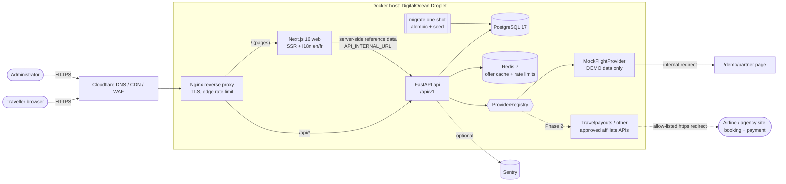

# Architecture

## Overview

### Request flows

**Search.** The browser POSTs `/api/v1/flights/search` (same origin, through Nginx).
The API validates the input (IATA format, existing airports, date window, passenger rules,
supported currency), fans out to every enabled provider concurrently with a timeout, and
caches each offer in Redis for 30 minutes under `offer:<id>`. It records an anonymous
`flight_search_events` row and returns offers **without redirect URLs**.

**Referral.** The browser POSTs `{offer_id}` to `/api/v1/referrals/click`. The API loads
the cached offer and asks the provider to build the redirect, then validates it: demo
offers may go only to the internal `/demo/partner` path, and live offers need
`https` plus an exact host match against the provider's allowlist. Live offers also
need `status = live`, a verified agreement, and `REFERRALS_LIVE_ENABLED=true`. The API
records a `referral_click_events` row and returns the URL. The client never supplies a
URL, so open redirects are not possible.

**Admin.** The browser POSTs credentials to `/api/v1/admin/auth/login`. The API sets an
opaque HttpOnly session cookie (SameSite=Strict, path `/api`) and a readable CSRF cookie.
The dashboard calls the admin GET endpoints; state-changing calls must echo the CSRF
token in `X-CSRF-Token`. All admin data comes from stored events.

### Components

| Component      | Responsibility                                                       | Key files                                                |
| -------------- | -------------------------------------------------------------------- | -------------------------------------------------------- |
| `apps/web`     | Pages, i18n routing (`/en`, `/fr`), search UI, results, admin UI     | `src/app/[locale]/**`, `src/proxy.ts`, `messages/*.json` |
| `apps/api`     | REST API, validation, provider orchestration, auth, analytics        | `app/main.py`, `app/api/v1/*.py`, `app/services/*.py`    |
| Provider layer | `FlightProvider` ABC, registry, mock implementation                  | `app/providers/{base,registry,mock}.py`                  |
| PostgreSQL     | System of record (reference data, events, commissions, admin, audit) | `app/models/*.py`, `alembic/versions/`                   |
| Redis          | Offer cache (TTL), fixed-window rate-limit counters                  | `app/core/cache.py`, `app/core/ratelimit.py`             |
| Nginx          | Single public entrypoint, same-origin routing, edge limits, headers  | `infrastructure/nginx/nginx.conf`                        |

### Design decisions

- **Same-origin API.** Nginx (production) and Next.js rewrites (development) serve `/api`
  on the site's own origin. Cookies can therefore be `SameSite=Strict` and CORS stays a
  strict allowlist.
- **User-driven calls go browser → API, not through Next.js.** Rate limits then apply per
  visitor. Next.js server components call the API only for unthrottled reference data
  (health, destinations), with a short timeout.
- **Async SQLAlchemy throughout.** Provider calls are async network I/O, so the API is
  async end-to-end (psycopg 3 async on PostgreSQL, aiosqlite in fast tests).
- **Enumerations as `CHECK` constraints**, not native PostgreSQL enums, so status values can
  evolve with ordinary migrations.
- **Localisation boundary.** The API returns codes (`demo_data`, `prices_may_change`,
  `provider_unavailable`, …) and the web app renders localised text. Destination content is
  stored per-locale in `destinations.translations`.
- **Dynamic rendering.** Pages render per request so legal identity and contact values
  (`LEGAL_ENTITY_NAME`, etc.) can change by environment without a rebuild.

### Visual design and media

- **Light theme only** (bright sky/sand palette).
- **Fonts** (Fraunces, Plus Jakarta Sans) are self-hosted at build time via `next/font`: no runtime calls to Google.
- **Animated logo** (`components/layout/Logo.tsx`): CSS-only airplane flight; replays on hover.
- **3D globe** (`components/Globe.tsx`): WebGL via [cobe](https://github.com/shuding/cobe) (MIT, ~5 KB),
  with markers for destinations and arcs from Montréal. It pauses off-screen, can be dragged,
  stays still for reduced-motion users, and falls back to a CSS sphere without WebGL.
- **Photos**: freely licensed Wikimedia Commons images, curated in `scripts/photos.manifest.json`
  and processed by `scripts/fetch_photos.py` into `apps/web/public/photos/*.webp`. Attribution
  data goes to `apps/web/src/content/photos.json` and is shown in captions and on `/credits`.
  Only CC0, public-domain, CC BY and CC BY-SA licences are accepted.

### Extensibility

- **New language:** add the code to `src/i18n/routing.ts`, add `messages/<code>.json`
  (the parity test enforces identical keys), add legal content in
  `src/content/legal/<code>.ts`, and add `translations.<code>` to destinations.
- **New currency:** insert a row in `currencies` and add the code to `CURRENCIES` in
  `apps/web/src/lib/search.ts`.
- **New provider:** see [PROVIDER_INTEGRATION.md](PROVIDER_INTEGRATION.md).
- **New destination photo:** add an entry to `scripts/photos.manifest.json` (key = destination slug)
  and run `python scripts/fetch_photos.py`.
