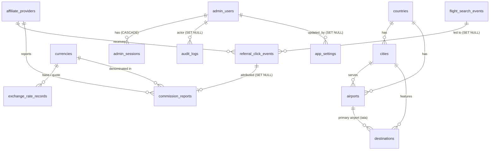

# Database

PostgreSQL 17 is the system of record. The schema is managed by Alembic
(`apps/api/alembic/versions/0001_initial_schema.py`, `0002_destination_facts.py`) and defined in SQLAlchemy models
(`apps/api/app/models/`). A test (`tests/test_migrations.py`) fails if models and
migrations drift, and checks that upgrade → downgrade → upgrade works on SQLite and,
in CI, PostgreSQL.

## Entity relationships



`system_error_events` is standalone (`provider_code` is informational, not a foreign key).

## Tables

| Table                   | Purpose                                            | Notable constraints and indexes                                                                                                                                      |
| ----------------------- | -------------------------------------------------- | -------------------------------------------------------------------------------------------------------------------------------------------------------------------- |
| `countries`             | ISO 3166-1 alpha-2 countries                       | PK `code` (2 chars)                                                                                                                                                  |
| `cities`                | Municipalities served by airports                  | unique (`name`, `country_code`); IANA `timezone`                                                                                                                     |
| `airports`              | 3,194 large/medium airports with scheduled service | unique `iata_code`; lat/lon range checks; `size` enum; `search_text` (lower-case, accent-stripped) for autocomplete; index (`is_active`, `size`)                     |
| `destinations`          | Editorial destination pages                        | unique `slug`; `translations` JSON `{en:{…}, fr:{…}}`; `facts` JSON `{best_months, currency, languages}`; FK `airport_iata`                                          |
| `currencies`            | ISO 4217 currencies offered                        | PK `code`; `minor_units` 0–4                                                                                                                                         |
| `exchange_rate_records` | Rates from a **named source**                      | `rate > 0`; base ≠ quote; unique (base, quote, effective_at, source). **None seeded**; conversion is refused without a record                                        |
| `affiliate_providers`   | Partners and their redirect allowlists             | unique `code`; `status ∈ {inactive, sandbox, live}`; CHECK: `live` requires `is_demo OR agreement_verified`                                                          |
| `flight_search_events`  | One anonymous row per search                       | status/trip/cabin enums; pax and date-order checks; indexes on `created_at`, (`origin`,`destination`), (`destination`,`created_at`)                                  |
| `referral_click_events` | One row per "View deal" click (incl. blocked)      | `status ∈ {redirected, blocked_live_disabled, blocked_host, expired}`; FK to search (SET NULL) and provider (RESTRICT)                                               |
| `commission_reports`    | Partner-reported earnings                          | `status ∈ {estimated, pending, approved, rejected, paid}`; `amount ≥ 0`; unique (`provider_id`, `external_reference`); `source ∈ {manual, provider_api, csv_import}` |
| `system_error_events`   | Unhandled API errors and provider failures         | `source ∈ {api, provider}`; message ≤ 500 chars, no request bodies                                                                                                   |
| `admin_users`           | Administrators                                     | unique lower-case `email`; Argon2id `password_hash`; `role ∈ {viewer, analyst, admin}`; lockout fields                                                               |
| `admin_sessions`        | Server-side sessions                               | unique `token_hash` (SHA-256 of the opaque token); `csrf_hash`; absolute and idle expiry                                                                             |
| `app_settings`          | Key/value JSON settings                            | PK `key`                                                                                                                                                             |
| `audit_logs`            | Security-relevant actions                          | `outcome ∈ {success, failure, denied}`; index on `action`, `created_at`                                                                                              |

## Privacy by design

- **No passenger identity, contact or payment data** exists anywhere in the schema.
- `client_hash` is `HMAC-SHA256(SECRET_KEY, "<UTC date>|<ip>")[:32]`. It rotates daily,
  cannot be reversed, and cannot be linked across days. Raw IPs are never stored.
- Retention is enforced by `python -m app.cli purge-expired` (schedule daily):

| Data                    | Default retention                           | Setting                        |
| ----------------------- | ------------------------------------------- | ------------------------------ |
| `flight_search_events`  | 395 days                                    | `RETENTION_SEARCH_EVENTS_DAYS` |
| `referral_click_events` | 760 days (commission reconciliation window) | `RETENTION_CLICK_EVENTS_DAYS`  |
| `system_error_events`   | 90 days                                     | `RETENTION_ERROR_EVENTS_DAYS`  |
| `audit_logs`            | 730 days                                    | `RETENTION_AUDIT_LOGS_DAYS`    |
| `admin_sessions`        | removed once expired or revoked             | none                           |

## Commission accounting rules

- A row exists only when a partner reports it (or an operator enters it from a partner
  statement). A click is **never** treated as revenue.
- Dashboard totals are grouped by `(status, currency)` and never summed across currencies.
- `estimated` and `pending` amounts are not earnings. Only `approved`/`paid` count toward
  the click-to-commission rate.

## Seed data

`python -m app.cli seed` is idempotent and inserts:

- 233 countries and 3,194 airports with cities. Source: OurAirports, public domain;
  rebuilt by `scripts/build_airport_dataset.py`.
- Currencies CAD, USD, EUR, GBP.
- The `mock` provider (`status=sandbox`, `is_demo=true`, empty allowlist).
- 12 destinations with original EN/FR copy and travel facts. Re-running `seed` refreshes
  destination content from `app/seed/data/destinations.json` (the repo is the source of truth).
- Default `app_settings`.

## Backup and restore

```bash
./scripts/backup_db.sh [dir]            # pg_dump -Fc, verified with pg_restore --list, keeps 14 newest
./scripts/restore_db.sh <file.dump>     # stops api/web, restores in one transaction, re-runs migrate
```

In production, also enable DigitalOcean Managed PostgreSQL point-in-time recovery (or
ship dumps off-host to encrypted object storage) and test a restore at least quarterly.

## Database access controls

- The application connects as a dedicated role that owns only the `gtp` database.
  In production, use separate roles: a migration role with DDL rights, and a runtime
  role with DML only (`GRANT SELECT, INSERT, UPDATE, DELETE`).
- PostgreSQL is not published outside the Docker network. Managed databases should
  restrict trusted sources to the app Droplet and require TLS (`sslmode=require`).
